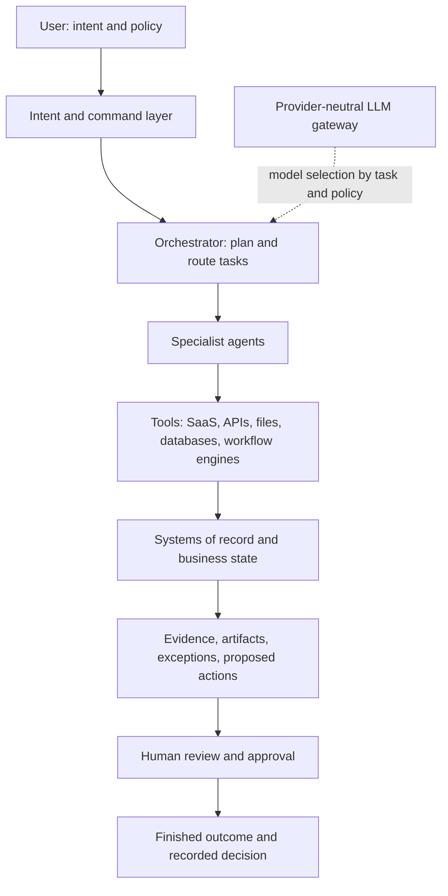

# Agentic operating model

## Design intent

The portfolio treats natural language as a command layer for expressing outcomes, not as a replacement for structured interfaces. A person states the goal and policy; the product scopes the work; agents use existing systems; the interface returns evidence, uncertainty, exceptions, and reviewable artifacts. People retain responsibility for consequential choices.

## Reference architecture

## Responsibility boundaries

| Layer | Responsibility | What it must not own |
|---|---|---|
| User | Desired outcome, constraints, policy, and consequential judgment | Repeating operational navigation across every source system |
| Intent layer | Capture a request, identify supported work, explain the scope | Pretend ambiguous intent is certain |
| Deterministic workflow | Identity keys, eligibility, validation, state transitions, calculations, deduplication, permissions, and audit events | Interpret unstructured meaning without a governed rule |
| Orchestrator | Decompose a supported objective, select the needed bounded tasks, handle order and dependencies | Override policy or silently perform consequential actions |
| Specialist agents | Retrieve, classify, compare, summarize, draft, and monitor within assigned scope | Make unsourced claims, invent evidence, or expand their own permissions |
| Tool layer | Read or write through approved connectors to existing systems | Become a new source of truth by accident |
| Systems of record | Preserve canonical business data and transaction state | Infer human intent or silently accept model output |
| Human review | Resolve exceptions, correct evidence, approve external or consequential work | Become a routine relay for deterministic work that can be safely validated |

## Deterministic, model-assisted, and human work

- **Deterministic rules** own repeatable validation: supported command routes, record identity, policy checks, score arithmetic, application state, deduplication, required fields, and audit records.
- **Models** can help interpret free text, map evidence to a user's criteria, summarize source conflicts, propose a plan, or draft language. Their outputs are suggestions with source references and uncertainty; they do not become business state on their own.
- **Agents** are task-bound executors that combine a scoped plan, model-assisted interpretation where useful, and approved tools. The architecture is provider-neutral; a governed gateway can choose a suitable OpenAI, Anthropic, Gemini, enterprise-hosted, or other model per task.
- **People** own identity ambiguity, external communication, application submission, supplier or customer commitments, important record changes, and policy exceptions.

## Execution states and evidence

The reusable command surface makes the work legible through `READY`, request scoping, `PLANNING`, `EXECUTING`, `WAITING FOR APPROVAL`, `BLOCKED`, and `COMPLETED`. It presents task responsibilities, records examined, source freshness, assumptions, confidence when meaningful, exceptions, and the returned artifact. It does not display private chain-of-thought.

The interaction pattern distinguishes:

- **Autonomous:** safe, reversible, local operations such as filtering, ranking, or retrieving evidence.
- **Reviewable:** preparation and analysis that the user can inspect and correct.
- **Approval required:** consequential external actions or important changes to canonical records.

If a command is unsupported, a source is missing, or a required record is ambiguous, the demo blocks the action and states what is missing. It does not invent a success state.

## Product examples

| Product | User intent | Bounded specialist work | Existing systems / data | Human control |
|---|---|---|---|---|
| Focusline | “Find the opportunities I should focus on today.” | Opportunity, company, network, relationship, and resume analysis as needed | Job and application records, resume variants, synthetic relationship history | Pursuit decision and any outreach or application submission |
| Thread | “Check this supplier change against the finance model.” | Retrieve source context, compare values, identify missing confirmation, prepare review | Documents, spreadsheets, messages, existing finance and operations records | Accepting a changed value, contacting a supplier, or changing a record |
| Prospecting operations | “Reconcile this export and surface safe follow-ups.” | Match identity, reconcile current exports, preserve interaction history, check eligibility | LinkedIn exports, interaction log, Google Sheets, workflow engine | Ambiguous identity and relationship outreach |
| Travel operations | “What needs intervention today?” | Validate required data, check SLA and exceptions, prepare a dispatch | Canonical order, routing rules, supplier system | Supplier dispatch and customer communication |
| Warehouse flow | “What should the warehouse review first?” | Rank evidence-backed candidates and explain variance | Inventory history, counts, warehouse records | Physical movement, stock adjustment, and financial posting |

## Demo implementation boundary

The public site uses a shared browser component for command entry, staged work, evidence, exceptions, and approval. Product adapters route supported commands to deterministic demo functions and synthetic local state. This is an interaction prototype, not a live multi-agent service: no LLM, LinkedIn, email, supplier, CRM, ERP, Google, or n8n connection is called by the public demos. A production backend can replace the local adapters without changing the interaction contract.

The key invariant is: **language for intent, structured UI for cognition, agents for bounded execution, and humans for consequential decisions.**

## Decision log

| Decision | Evidence → inference → decision |
|---|---|
| Use a shared command surface across demos | Users express outcomes but still need different operational workspaces → the command model can be reused while evidence and controls remain domain-specific → share the execution pattern, not one generic chat UI. |
| Keep product screens | Comparing roles, sources, records, and exceptions benefits from stable structured context → chat alone obscures state and trade-offs → preserve tables, timelines, and detail panels for cognition and review. |
| Make simulations explicit | The static portfolio has no connected models or tools → implied live automation would overstate capability → label local execution and never claim external action. |
| Keep model choice abstract | Product workflows should outlast a provider choice → provider-specific UI would couple the product to one model → describe an organization-governed gateway and task policy. |
| Require human approval for consequential actions | External messages, submissions, supplier dispatch, and system-of-record changes can create obligations → a recommendation is not authorization → prepare the action and return it for explicit review. |
